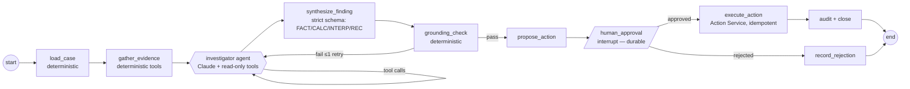

# AGENT_DESIGN

> Agent roadmap, investigation graph, responsibility matrix, tool design rules and shared state.
> Derived from the approved baseline `00_PROJECT_INITIATION.md` (2026-11-02). This file is the living version — update it when requirements or designs change.

## 11. Agent responsibility matrix

### 11.1 Staged agent roadmap (challenge to the brief)

| Brief proposed | Our proposal | Reason |
|---|---|---|
| A. Orchestrator Agent | **Phase 4a:** deterministic graph (no LLM routing needed for "investigate invoice X"). **Phase 4b:** lightweight LLM router for free-text chat (fast, cheap model) | Routing "investigate" requests through an LLM wastes latency; free text does need it |
| B. ERP Data Analyst | **Yes** — core agent (tools: invoice, PO, GR, match, KPI) | Highest value |
| C. Document Intelligence | **Yes** — Phase 4b specialist (or a tool of the investigator in 4a) | Separate prompt with citation rules; isolated context keeps long passages away from analytics reasoning |
| D. Supplier Intelligence | **Tools first** (`get_supplier_performance`, `get_supplier_risk`) used by the ERP Analyst; promote to an agent only if eval shows a need | It is a set of queries, not a distinct reasoning skill |
| E. Business Process Agent | **Tools first** (`get_stage_lead_times`, `get_backlog_ageing`) — same logic | Same |
| F. Decision Support | **Synthesis node** with a strict output schema (not a free-roaming agent) | Its job is structured combination plus labeling — a single structured LLM call |
| G. Workflow Execution Agent | **Not an LLM agent.** Deterministic Action Service behind an approval interrupt; the LLM only drafts supplier messages | Writes must be deterministic, permissioned and idempotent |

Explicit **promotion criterion** for splitting a tool group into its own agent: tool-selection accuracy < 90 % or task success drops > 5 pp when the tool group is added to the shared agent, measured on the eval set.

### 11.2 Investigation graph (Phase 4a/5)

Note from the LangGraph docs: on resume, the interrupted node **re-runs from the start**. So `human_approval` must contain no side effects before `interrupt()`, and execution lives in a separate node — exactly as designed above.

### 11.3 Responsibility matrix

| Component | Type | Responsibilities | Tools / inputs | Data access | Model **[ASSUMPTION]** | Output contract | Phase |
|---|---|---|---|---|---|---|---|
| Router | LLM (small) | Classify the free-text request → workflow (investigate / analytics / policy Q&A / report) | none (structured output) | none | Claude Haiku 5.5 | `RouteDecision` enum + extracted IDs | 4b |
| Investigator / ERP Data Analyst | LLM agent | Investigate exceptions, answer data questions, supplier and process analysis | `get_invoice`, `get_po`, `get_goods_receipts`, `get_match_result`, `find_duplicate_candidates`, `list_exceptions`, `compute_kpi`, `get_supplier_performance`, `get_supplier_risk`, `get_stage_lead_times` | read-only views via services | Claude Sonnet 5.5 | Evidence list + interim notes | 4a |
| Document Intelligence | LLM agent | Find and quote contract/policy passages; say "not found" when absent | `search_documents(query, doc_types, supplier_id, as_of)`, `get_contract_terms` | `docs` (read) | Claude Sonnet 5.5 (or Haiku if eval allows) | `PolicyEvidence[]` with citations | 4a tool → 4b agent |
| Decision Support | LLM node (single call) | Combine evidence into a labeled finding and recommendation with options, risks and € impact | state only | none | Claude Sonnet 5.5 | `CaseFinding` (strict schema) | 4a |
| Grounding Check | Deterministic | Every number in the finding exists in tool outputs; every policy claim has a valid citation ID | state | none | — | pass/fail + violations | 4a |
| Action Proposer | Deterministic | Map the recommendation → typed `ActionRequest`, check limits, set the approver role | state | `ops` (insert PENDING) | — | `ActionRequest` | 5 |
| Action Service | Deterministic | Execute approved actions idempotently; write the ERP simulation; audit | approved request | `eops_action` role | — | execution result | 5 |
| Message Drafter | LLM (single call) | Draft supplier inquiry / credit-memo request text from the finding | finding | none | Claude Haiku 5.5 | draft text (never sent automatically) | 5 |

**Tool design rules:** strict JSON schemas (`strict: true`, `additionalProperties: false`), enums for KPI names and exception codes, bounded result sizes (top-N + totals), every tool result carries a `source_ref` (table + key or chunk ID) that the grounding check uses, and every tool call is logged with its arguments.

### 11.4 Shared state (conceptual)
`InvestigationState`: `case_id`, `invoice_id`, `user {id, role, approval_limit}`, `messages`, `evidence[] {source_ref, payload}`, `citations[]`, `finding: CaseFinding | None`, `grounding: {passed, violations}`, `proposed_action: ActionRequest | None`, `approval: {status, approver, comment}`, `budget {tokens_used, tool_calls, max}`, `trace_id`.
