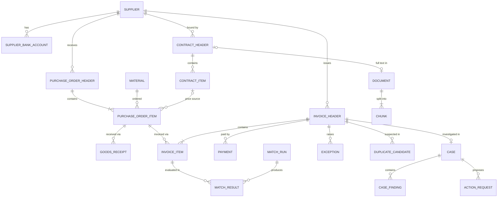

# DATABASE_SCHEMA

> Target data model (SAP-aligned), schemas, entities, relationships and migration history.
> Derived from the approved baseline `00_PROJECT_INITIATION.md` (2026-11-02). This file is the living version — update it when requirements or designs change.

## 10. Initial database entities and relationships

Four schemas separate concerns and permissions: `erp` (the simulated source system, SAP-aligned), `ops` (EnterpriseOps' own results and workflow), `docs` (RAG corpus), `audit`. LangGraph checkpoint tables live in their own schema, managed by the checkpointer library.

### 10.1 Entity list with SAP mapping

| Schema.Entity | Key attributes | SAP analogue |
|---|---|---|
| `erp.company_code` | code, name, currency | T001 |
| `erp.supplier` | supplier_id, name, country, vat_id, payment_terms, created_at, blocked | LFA1 / Business Partner |
| `erp.supplier_bank_account` | supplier_id, iban_masked, iban_hash, valid_from, changed_by | LFBK / BP bank |
| `erp.material` | material_id, description, material_group, base_uom | MARA |
| `erp.contract_header` / `contract_item` | contract_id, supplier_id, valid_from/to, document_id → `docs.document`; item: material_id, agreed_price, currency, price_unit | EKKO/EKPO (doc. category K) |
| `erp.purchase_order_header` | po_number, supplier_id, company_code, purch_org, created_at, created_by, currency, payment_terms | EKKO |
| `erp.purchase_order_item` | (po_number, item_no), material_id, qty, uom, net_price, price_unit, promised_delivery_date, gr_based_iv, contract ref, deletion_flag | EKPO / EKET |
| `erp.goods_receipt` | (mat_doc, year, line), po_number, po_item, movement_type (101/102), qty, posting_date, plant | MATDOC (MSEG) |
| `erp.invoice_header` | invoice_id, supplier_id, company_code, supplier_reference, invoice_date, received_date, posting_date, gross/net/tax, currency, payment_terms, payment_block, status, doc_type (invoice / credit memo) | RBKP |
| `erp.invoice_item` | (invoice_id, item_no), po_number, po_item, qty, amount, unit_price, tax_code | RSEG |
| `erp.payment` | payment_id, invoice_id, payment_date, amount, discount_taken | BSAK / payment run |
| `erp.inventory_level` | material_id, plant, qty, as_of (minimal — no v1 use case needs more) | MARD |
| `ops.tolerance_rule` | company_code, tolerance_key, lower/upper abs & pct, policy document ref | OMR6 config |
| `ops.match_run` | run_id, started_at, engine_version, params hash | — |
| `ops.match_result` | run_id, invoice_id, item_no, status, qty_variance, price_variance, tolerance_applied | — |
| `ops.exception` | exception_id, invoice_id, item_no, code, severity, amount_at_risk, status, detected_run_id | — |
| `ops.duplicate_candidate` | invoice_id, candidate_invoice_id, score, feature_breakdown (JSONB) | — |
| `ops.case` | case_id, invoice_id, status, assigned_to, opened/closed_at | — |
| `ops.case_finding` | case_id, agent_run_id, facts/calcs/interps/recs (JSONB, schema-validated), citations, confidence, model, prompt_version | — |
| `ops.action_request` | action_id, case_id, type, payload, status (PENDING/APPROVED/REJECTED/EXECUTED/FAILED), proposed_by, approved_by, amount, idempotency_key | — |
| `ops.agent_run` | run_id, thread_id, user_id, started/ended, tokens_in/out, cost_eur, latency_ms, outcome | — |
| `docs.document` | document_id, doc_type (CONTRACT/POLICY/PROCEDURE), supplier_id?, title, version, valid_from/to, checksum, source_uri | DMS |
| `docs.chunk` | chunk_id, document_id, section_path, page, text, tsv (tsvector), embedding (vector) | — |
| `audit.audit_event` | event_id, ts, actor_type (HUMAN/AGENT/SYSTEM), actor_id, action, entity_type, entity_id, before/after (JSONB), trace_id, prev_hash, hash | — |
| `iam.app_user` / `iam.role` | user_id, role, approval_limit_eur | — |

### 10.2 Core ER diagram



### 10.3 Data-design decisions worth noting
- **Composite natural keys** for SAP-like objects (`po_number + item_no`) plus surrogate IDs where convenient, so the data reads as recognizably SAP to an SAP reviewer.
- **GR reversals are separate rows** (movement type 102) — never updates. This reflects how ERP systems keep history, and it is a classic source of matching bugs.
- **Invoices vs. credit memos** share one table (`doc_type`), as in RBKP.
- **Validity dating** (`valid_from/to`) on contracts, bank accounts and documents → enables "as-of" questions and the bank-change fraud check.
- **Curated SQL views** (`erp_v.*`) are the *only* surface the agent's DB role can see.
- **Embedding dimension** is fixed by the chosen model (pgvector indexes `vector` up to 2,000 dims and `halfvec` up to 4,000), so the model choice (Q3) must happen before the docs schema migration.

### 10.4 Synthetic data plan (Phase 2 preview)
- Scale: ~60 suppliers, ~400 materials, ~3,000 POs / ~9,000 PO items, ~8,000 GR lines, ~4,000 invoices over 18 months, 2 company codes. **[ASSUMPTION]**
- Supplier "personas" with different behavior (reliable / chronically late / price-creep / sloppy invoicer / one fraud-like bank change).
- **Seeded exceptions at realistic rates** (≈ 15–25 % of invoices with ≥ 1 exception), each recorded in a hidden `ground_truth_label` table used *only* by evaluation. Hard negatives included: e.g., same-reference credit memos and split deliveries that look like quantity variances but are legitimate.
- Deterministic random seed → reproducible dataset.

---

## Implementation status

**Source of truth:** `backend/app/db/tables.py` (SQLAlchemy Core). Migrations are generated from it with
`alembic revision --autogenerate`, reviewed, and committed; `tests/test_schema_drift.py` fails if the
migrated database and `tables.py` ever disagree (ADR-017). Constraint names follow a fixed naming
convention (`pk_`, `fk_`, `uq_`, `ix_`, `ck_<table>_<name>`).

### How to change the schema
```bash
cd backend
# 1. edit app/db/tables.py
uv run alembic revision --autogenerate -m "short description"   # 2. generate
# 3. review the new file in migrations/versions/ (add grants / data changes by hand, mark them MANUAL)
uv run alembic upgrade head && uv run pytest                    # 4. apply + drift test
```

### Schemas
| Schema | Purpose | Created in | Tables |
|---|---|---|---|
| `erp` | Simulated SAP-aligned source system | 0001 | 15 (0002) |
| `ops` | Configuration and matching results | 0001 | 6 (1 in 0002, 5 in 0003) |
| `docs` | RAG corpus | 0001 | none yet (Task 4) |
| `audit` | Append-only audit trail | 0001 | none yet (Task 5) |
| `iam` | Users and business roles | 0001 | 2 (0002) |
| `eval` | Ground truth for evaluation, **never visible to agents** (ADR-018) | 0002 | 3 (0002) |
| `agent` | Curated read-only **views** — the only objects the agent role can read (ADR-022) | 0003 | 9 views |

### Tables (migration 0002)
Money `NUMERIC(15,2)`, unit prices `NUMERIC(15,4)`, quantities `NUMERIC(13,3)` (ADR-012).

| Table | Key | Important columns / rules | SAP analogue |
|---|---|---|---|
| `erp.company_code` | company_code | DE01 (EUR), US01 (USD) | T001 |
| `erp.plant` | plant_id | DE11, DE12, US11 | T001W |
| `erp.payment_terms` | terms_code | net_days, discount_days/pct (both set or both NULL) | T052 |
| `erp.supplier` | supplier_id | vat_id (indexed: duplicate vendor masters share it), terms_code | LFA1 / BP |
| `erp.supplier_bank_account` | bank_account_id | iban_masked + SHA-256 iban_hash only (no clear IBAN), valid_from/valid_to history | LFBK |
| `erp.material` | material_id | material_group, base_uom, standard_price | MARA/MBEW |
| `erp.contract_header` / `contract_item` | contract_id (+ item_no) | validity dates, agreed_price per material | EKKO/EKPO (cat. K) |
| `erp.purchase_order_header` | po_number | supplier, company, doc_date, currency, terms_code | EKKO |
| `erp.purchase_order_item` | (po_number, item_no) | quantity, net_price per unit, delivery_date (promised), gr_based_iv, optional contract reference | EKPO/EKET |
| `erp.goods_receipt` | (mat_doc, mat_doc_year, line_no) | movement_type 101 receipt / 102 reversal (separate row, references the 101), quantity always > 0 | MATDOC/MSEG |
| `erp.invoice_header` | invoice_id | doc_type INVOICE/CREDIT_MEMO, supplier_reference, invoice/received/posting dates, net+tax=gross (CHECK), status RECEIVED/PAID, payment_block (set by matching, Task 3), reference_invoice_id for credit memos | RBKP |
| `erp.invoice_item` | (invoice_id, item_no) | optional PO reference (NULL = non-PO line), quantity, unit_price, net_amount | RSEG |
| `erp.payment` | payment_id | payment_date, amount, discount_taken | payment run / BSAK |
| `erp.inventory_level` | (material, plant, as_of) | stock snapshot (minimal) | MARD |
| `iam.role` | role_code | approval_limit_eur — seeded by the migration (8 roles) | — |
| `iam.app_user` | user_id | role_code, email (`*.example` domain) | — |
| `ops.tolerance_rule` | (company_code, tolerance_key) | PP / DQ / BD limits, policy_ref (semantics: ADR-016, PROJECT_REQUIREMENTS §8.2) | OMR6 |
| `eval.dataset_run` | run_id | seed, profile, generator_version, row_counts, content_hash | — |
| `eval.supplier_persona` | supplier_id | hidden behavior profile used by the generator | — |
| `eval.ground_truth_label` | label_id | invoice_id, item_no (NULL = invoice level), label_code, is_hard_negative, details (JSONB) | — |

### Matching result tables (migration 0003)
| Table | Key | Content |
|---|---|---|
| `ops.match_run` | run_id | engine_version, params (JSONB: tolerances + duplicate settings), params_hash, status, triggered_by, counts |
| `ops.invoice_result` | (run_id, invoice_id) | MATCHED / WITHIN_TOLERANCE / BLOCKED / FLAGGED / NOT_APPLICABLE, blocks_payment, exception_count, amount_at_risk |
| `ops.line_result` | (run_id, invoice_id, item_no) | po_qty, net_received_qty, previously_invoiced_qty, invoiced_qty, po/invoice price, price variance amount/%, price_outcome, qty_outcome |
| `ops.exception` | exception_id | run_id, invoice_id, item_no (NULL = invoice level), code, severity, blocks_payment, amount_at_risk, currency, details (JSONB evidence), status |
| `ops.duplicate_candidate` | (run_id, invoice_id, candidate_invoice_id) | score, is_flagged, features (JSONB) |

Runs are appended, never overwritten (ADR-023). Reloading the synthetic dataset truncates `ops.match_run`
and, via CASCADE, all results (derived data).

### Agent views (schema `agent`, migration 0003)
`latest_match_run`, `invoice_overview`, `invoice_line_match`, `goods_receipt_line`, `purchase_order`,
`contract_price`, `supplier_profile` (bank details reduced to `last_bank_change_date`), `open_exception`,
`duplicate_pair`. All result views show the **latest completed run**. Views run with the owner's
privileges, so `eops_agent_ro` needs no table access.

### Business roles (seeded in `iam.role`)
| Role | Approval limit (EUR) |
|---|---|
| AP_CLERK | — (proposes only) |
| AP_MANAGER | 25,000 |
| FINANCE_MANAGER | 250,000 |
| BUYER, PROCUREMENT_MANAGER, FINANCE_VIEWER, AUDITOR | — |
| ADMIN | — (no business approvals: segregation of duties) |

### Database roles and privileges (ADR-020, ADR-022, ADR-024)
Group roles (`NOLOGIN`), created by migration 0002 if missing. Login users for the application are added in Task 5.

| Privilege | `eops_agent_ro` | `eops_app` | `eops_action` |
|---|---|---|---|
| Read `agent` views | ✅ | ✅ | ❌ |
| Read `erp` tables | ❌ (since 0003) | ✅ | ✅ |
| Write `erp` | ❌ | only `invoice_header.payment_block` (ADR-024) | ✅ INSERT/UPDATE, no DELETE |
| Read / write `ops` | ❌ / ❌ | ✅ / ✅ | ❌ / ❌ |
| Read `iam` | ❌ | ✅ | ✅ |
| Read `eval` | ❌ | ❌ | ❌ |

Verified by `tests/test_db_roles.py`: the agent role reads all 9 views but is denied on erp/ops tables,
bank accounts, `iam` and `eval`; the app role can set `payment_block` but not `status`; no agent view has
an IBAN column.

### Migration history
| Revision | Date | Description | Reversible |
|---|---|---|---|
| `0001` | 2026-11-02 | Baseline: `CREATE EXTENSION vector`; schemas `erp, ops, docs, audit, iam` | Yes |
| `0002` | 2026-11-02 | 21 tables in `erp`, `iam`, `ops`, `eval`; `eval` schema; 8 business roles; DB group roles + grants | Yes (revokes privileges; cluster-wide roles are intentionally not dropped) |
| `0003` | 2026-11-02 | 5 matching result tables in `ops`; schema `agent` with 9 views; agent role narrowed to views; column grant on `payment_block` | Yes (drops views, restores 0002 grants) |

### Databases
| Database | Use |
|---|---|
| `eops` | Development data (docker compose volume `pgdata`) |
| `eops_test` | Automated tests only (created by `infra/postgres/init/01-create-test-database.sql`) |

## Synthetic dataset (Task 2)

Generated by `backend/data_generation/` — see TESTING_AND_EVALUATION.md §5 for scenarios, labels and validation.

```bash
cd backend
uv run python -m data_generation generate --seed 42 --profile full   # load into EOPS_DATABASE_URL
uv run python -m data_generation validate                             # re-run the checks
```

| Profile | Suppliers | Materials | POs | Invoices | GR lines | Invoices with exception |
|---|---|---|---|---|---|---|
| `full` (seed 42, generator 1.1.0) | 61 | 400 | 3,030 | 3,496 + 55 credit memos | 7,604 | 18.9 % |
| `small` (seed 42) | 21 | 80 | ~320 | ~375 | ~790 | ~18 % |
