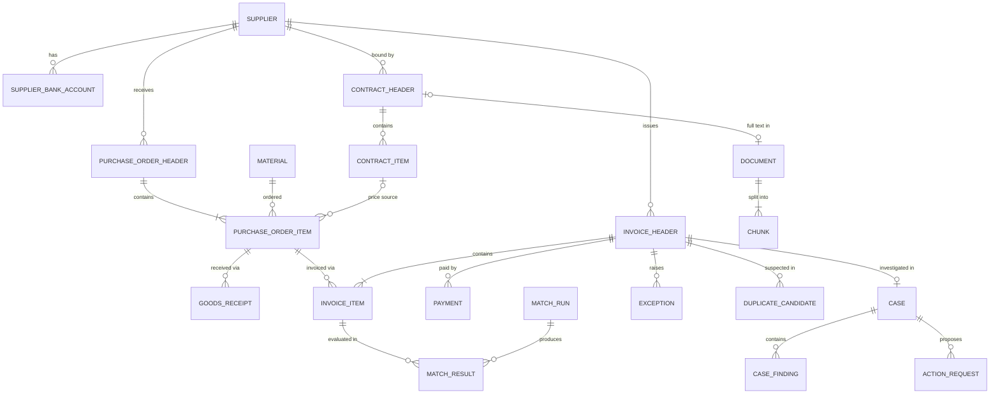

# DATABASE_SCHEMA

> Target data model (SAP-aligned), schemas, entities, relationships and migration history.
> Derived from the approved baseline `00_PROJECT_INITIATION.md` (2026-11-02). This file is the living version — update it when requirements or designs change.

## 10. Initial database entities and relationships

Four schemas separate concerns and permissions: `erp` (the simulated source system, SAP-aligned), `ops` (EnterpriseOps' own results and workflow), `docs` (RAG corpus), `audit`. LangGraph checkpoint tables live in their own schema, managed by the checkpointer library.

### 10.1 Entity list with SAP mapping

| Schema.Entity | Key attributes | SAP analogue |
|---|---|---|
| `erp.company_code` | code, name, currency | T001 |
| `erp.supplier` | supplier_id, name, country, vat_id, payment_terms, created_at, blocked | LFA1 / Business Partner |
| `erp.supplier_bank_account` | supplier_id, iban_masked, iban_hash, valid_from, changed_by | LFBK / BP bank |
| `erp.material` | material_id, description, material_group, base_uom | MARA |
| `erp.contract_header` / `contract_item` | contract_id, supplier_id, valid_from/to, document_id → `docs.document`; item: material_id, agreed_price, currency, price_unit | EKKO/EKPO (doc. category K) |
| `erp.purchase_order_header` | po_number, supplier_id, company_code, purch_org, created_at, created_by, currency, payment_terms | EKKO |
| `erp.purchase_order_item` | (po_number, item_no), material_id, qty, uom, net_price, price_unit, promised_delivery_date, gr_based_iv, contract ref, deletion_flag | EKPO / EKET |
| `erp.goods_receipt` | (mat_doc, year, line), po_number, po_item, movement_type (101/102), qty, posting_date, plant | MATDOC (MSEG) |
| `erp.invoice_header` | invoice_id, supplier_id, company_code, supplier_reference, invoice_date, received_date, posting_date, gross/net/tax, currency, payment_terms, payment_block, status, doc_type (invoice / credit memo) | RBKP |
| `erp.invoice_item` | (invoice_id, item_no), po_number, po_item, qty, amount, unit_price, tax_code | RSEG |
| `erp.payment` | payment_id, invoice_id, payment_date, amount, discount_taken | BSAK / payment run |
| `erp.inventory_level` | material_id, plant, qty, as_of (minimal — no v1 use case needs more) | MARD |
| `ops.tolerance_rule` | company_code, tolerance_key, lower/upper abs & pct, policy document ref | OMR6 config |
| `ops.match_run` | run_id, started_at, engine_version, params hash | — |
| `ops.match_result` | run_id, invoice_id, item_no, status, qty_variance, price_variance, tolerance_applied | — |
| `ops.exception` | exception_id, invoice_id, item_no, code, severity, amount_at_risk, status, detected_run_id | — |
| `ops.duplicate_candidate` | invoice_id, candidate_invoice_id, score, feature_breakdown (JSONB) | — |
| `ops.case` | case_id, invoice_id, status, assigned_to, opened/closed_at | — |
| `ops.case_finding` | case_id, agent_run_id, facts/calcs/interps/recs (JSONB, schema-validated), citations, confidence, model, prompt_version | — |
| `ops.action_request` | action_id, case_id, type, payload, status (PENDING/APPROVED/REJECTED/EXECUTED/FAILED), proposed_by, approved_by, amount, idempotency_key | — |
| `ops.agent_run` | run_id, thread_id, user_id, started/ended, tokens_in/out, cost_eur, latency_ms, outcome | — |
| `docs.document` | document_id, doc_type (CONTRACT/POLICY/PROCEDURE), supplier_id?, title, version, valid_from/to, checksum, source_uri | DMS |
| `docs.chunk` | chunk_id, document_id, section_path, page, text, tsv (tsvector), embedding (vector) | — |
| `audit.audit_event` | event_id, ts, actor_type (HUMAN/AGENT/SYSTEM), actor_id, action, entity_type, entity_id, before/after (JSONB), trace_id, prev_hash, hash | — |
| `iam.app_user` / `iam.role` | user_id, role, approval_limit_eur | — |

### 10.2 Core ER diagram

### 10.3 Data-design decisions worth noting
- **Composite natural keys** for SAP-like objects (`po_number + item_no`) plus surrogate IDs where convenient, so the data reads as recognizably SAP to an SAP reviewer.
- **GR reversals are separate rows** (movement type 102) — never updates. This reflects how ERP systems keep history, and it is a classic source of matching bugs.
- **Invoices vs. credit memos** share one table (`doc_type`), as in RBKP.
- **Validity dating** (`valid_from/to`) on contracts, bank accounts and documents → enables "as-of" questions and the bank-change fraud check.
- **Curated SQL views** (`erp_v.*`) are the *only* surface the agent's DB role can see.
- **Embedding dimension** is fixed by the chosen model (pgvector indexes `vector` up to 2,000 dims and `halfvec` up to 4,000), so the model choice (Q3) must happen before the docs schema migration.

### 10.4 Synthetic data plan (Phase 2 preview)
- Scale: ~60 suppliers, ~400 materials, ~3,000 POs / ~9,000 PO items, ~8,000 GR lines, ~4,000 invoices over 18 months, 2 company codes. **[ASSUMPTION]**
- Supplier "personas" with different behavior (reliable / chronically late / price-creep / sloppy invoicer / one fraud-like bank change).
- **Seeded exceptions at realistic rates** (≈ 15–25 % of invoices with ≥ 1 exception), each recorded in a hidden `ground_truth_label` table used *only* by evaluation. Hard negatives included: e.g., same-reference credit memos and split deliveries that look like quantity variances but are legitimate.
- Deterministic random seed → reproducible dataset.

---

## Implementation status

### Schemas
| Schema | Purpose | Created in |
|---|---|---|
| `erp` | Simulated SAP-aligned source system | 0001 |
| `ops` | Matching results, exceptions, cases, actions | 0001 |
| `docs` | RAG corpus (documents, chunks, embeddings) | 0001 |
| `audit` | Append-only audit trail | 0001 |
| `iam` | Users and roles | 0001 |

Tables: **none yet** (Task 2). Extension: `vector` (pgvector) installed by migration 0001.

### Migration history
| Revision | Date | Description | Reversible |
|---|---|---|---|
| `0001` | 2026-11-02 | Baseline: `CREATE EXTENSION vector`; create schemas `erp, ops, docs, audit, iam` | Yes (`DROP SCHEMA … RESTRICT` refuses to drop non-empty schemas) |

### Databases
| Database | Use |
|---|---|
| `eops` | Development data (docker compose volume `pgdata`) |
| `eops_test` | Automated tests only (created by `infra/postgres/init/01-create-test-database.sql`) |

### Planned database roles (Task 2)
`eops_agent_ro` (SELECT on curated views only), `eops_app`, `eops_action` — see NFR-SEC-02 and `SYSTEM_ARCHITECTURE.md` §9.4. Until then, development uses the single owner role from `.env`.
