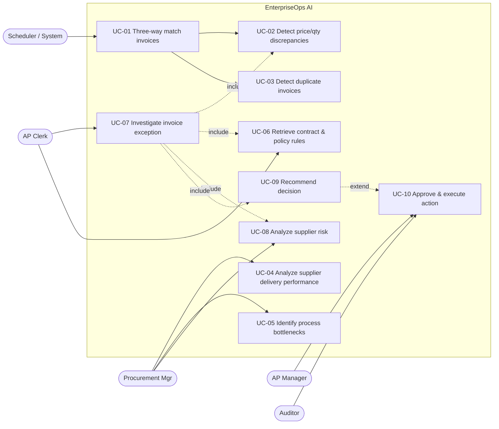
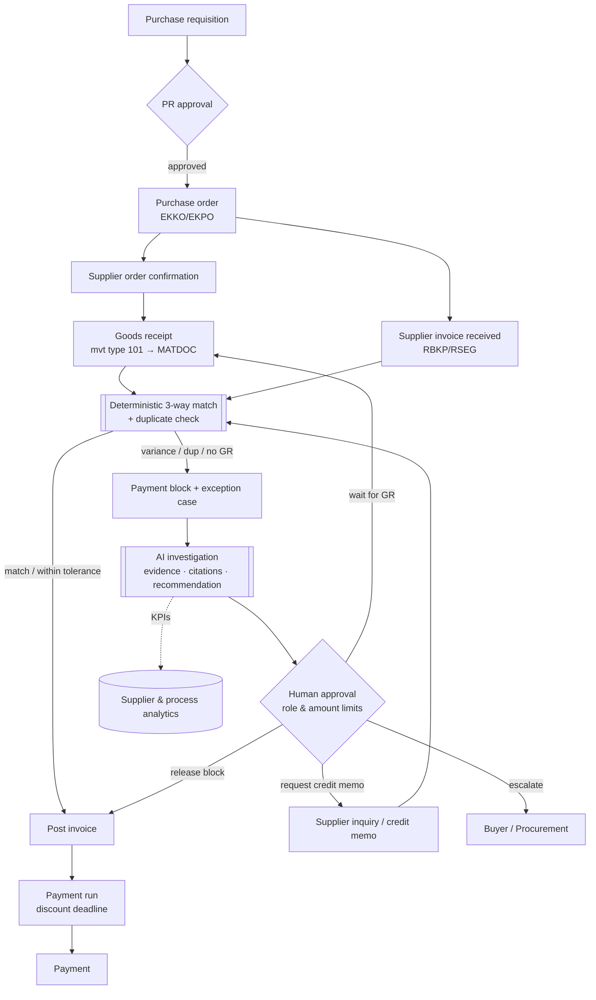

# PROJECT_REQUIREMENTS

> Business problem, objectives, stakeholders, requirements, use cases, P2P process, KPIs, assumptions and open questions.
> Derived from the approved baseline `00_PROJECT_INITIATION.md` (2026-11-02). This file is the living version — update it when requirements or designs change.

## 1. Executive summary

Accounts-payable (AP) teams spend a large share of their time on invoices that fail automatic matching against purchase orders and goods receipts. Each blocked invoice triggers manual detective work across the ERP system, email threads, supplier contracts and procurement policies. That work is slow, inconsistent and hard to audit, and late resolution costs cash discounts and damages supplier relationships.

**EnterpriseOps AI** is a decision-support and workflow platform for this problem. It combines:

- a **deterministic matching engine** (three-way match, tolerance checks, duplicate detection) that runs on an SAP-aligned ERP data model;
- an **AI investigation layer** (LangGraph-orchestrated Claude agents) that explains *why* an invoice was flagged, pulls in the relevant contract clauses and policy rules with citations, analyzes supplier history and proposes a resolution;
- a **human-in-the-loop action workflow** (approve/reject, role-based limits, four-eyes principle) with a tamper-evident audit trail;
- an **evaluation harness** that measures matching accuracy, retrieval quality, grounding/hallucination, task success, latency and cost.

The product is "SAP-aligned, not SAP-integrated". The data model and adapter interface mirror S/4HANA procurement objects and APIs, so a real connector is a documented next step. It is not a claim of a working SAP integration.

**Portfolio value:** it shows end-to-end enterprise AI engineering: business process analysis, data engineering, RAG with traceable sources, reliable tool calling, durable agent workflows with approvals, security controls and *measured* AI quality.

## 2. Business problem statement

**Context.** In Procure-to-Pay (P2P), a supplier invoice should only be paid if it matches what was ordered (purchase order, PO) and what was received (goods receipt, GR). This is the *three-way match*. In SAP this happens in Logistics Invoice Verification (transaction MIRO / the Supplier Invoice app), where configurable tolerance limits decide whether variances block the invoice for payment.

**Problem.** When an invoice is blocked, the AP clerk must:
1. find the PO, GR history and previous invoices for the PO line;
2. work out *which* variance caused the block (price, quantity, missing GR, duplicate suspicion, and so on);
3. check the supplier contract (agreed prices, price-adjustment clauses, payment terms) and internal policy (tolerances, approval limits);
4. check the supplier's history (is this a pattern?);
5. decide on a resolution (release the block, request a credit memo, wait for the GR, escalate) and document it.

Today this is manual, spread across systems, inconsistent between clerks and weakly documented. **Consequences:** long exception cycle times, lost early-payment discounts, duplicate-payment leakage, late-payment friction with suppliers, and poor visibility for procurement on which suppliers and processes cause the exceptions.

**Problem statement (one sentence).** *AP and procurement teams lack a fast, consistent and auditable way to investigate and resolve invoice exceptions using both structured ERP data and unstructured contracts and policies.*

## 3. Business objectives

The baselines and targets below are for the **simulated environment**. They are demo targets measured on our synthetic dataset, not claims about real companies. **[ASSUMPTION]**

| ID | Objective | KPI (formula in §8.4) | Target (simulated) |
|---|---|---|---|
| BO-1 | Detect all invoice exceptions reliably | Matching precision / recall vs. seeded labels | ≥ 0.99 / ≥ 0.99 (deterministic engine) |
| BO-2 | Cut investigation effort per exception | Time-to-explanation (agent) | p95 < 45 s per investigation |
| BO-3 | Prevent duplicate payments | Duplicate detection recall at chosen threshold; € value prevented | Recall ≥ 0.95, precision ≥ 0.85 |
| BO-4 | Make recommendations trustworthy | Grounded-number rate; citation accuracy | 100 % numbers traceable; ≥ 90 % citations support the claim |
| BO-5 | Keep humans in control | Unapproved write actions executed | **0** (hard requirement) |
| BO-6 | Give procurement supplier insight | Supplier OTIF, discrepancy rate, avg. delay available per supplier/period | Available via dashboard and agent |
| BO-7 | Operate economically | LLM cost per investigation | < €0.10 average **[ASSUMPTION — validate in week 5]** |

## 4. Stakeholder analysis

| Stakeholder | Role in P2P | Interest / pain | Influence | How the system serves them | System role (RBAC) |
|---|---|---|---|---|---|
| AP Clerk | Processes and resolves invoices | Too much manual investigation | Medium | Explained exceptions, evidence pack, drafted resolutions | `AP_CLERK` |
| AP Team Lead | Approves resolutions, owns AP KPIs | Backlog, cycle time, discount loss | High | Approval queue, KPI dashboard, four-eyes control | `AP_MANAGER` |
| Buyer / Purchaser | Creates POs, owns supplier relationship | Gets pulled into disputes late | Medium | Supplier follow-up drafts, PO-related root causes | `BUYER` |
| Procurement / Category Manager | Supplier strategy, contracts | No data on supplier reliability | High | Supplier performance and risk analysis | `PROCUREMENT_MANAGER` |
| Warehouse / Goods Receiving | Posts goods receipts | Late GR postings cause blocks | Low | Bottleneck analysis exposes GR delays | (read via reports) |
| Controller / Finance Manager (CFO office) | Cash, working capital, compliance | Duplicate payments, discount capture | High | Financial KPIs, € at risk | `FINANCE_VIEWER` |
| Internal Audit / Compliance | Controls, SoD | Need traceable decisions | High | Immutable audit log, decision rationale | `AUDITOR` (read-only) |
| Supplier | Gets paid | Late payment, unclear disputes | Low (external) | Clear, fact-based follow-up messages | none |
| IT / ERP team | Runs SAP and integrations | Security, stability, no uncontrolled writes | High | Read-only by default, adapter boundary, no free SQL | `ADMIN` |
| Data Protection Officer | GDPR | Personal data in supplier contacts | Medium | Synthetic data, minimization, no PII to the LLM where avoidable | n/a |
| *Portfolio audience* (recruiters, professors) | Evaluate you | Real engineering, not a toy chatbot | — | README, architecture, evaluation report, demo | n/a |

**Segregation of duties (SoD):** the person (or agent) who *proposes* an action can never be the one who *approves* it. Approval limits are tied to role and amount (see FR-WF-04).

## 5. Functional requirements

Priority uses MoSCoW: **M**ust / **S**hould / **C**ould / **W**on't (this release).

### 5.1 ERP data & matching (deterministic core)
| ID | Requirement | Prio |
|---|---|---|
| FR-DM-01 | Store SAP-aligned master and transactional data: suppliers, materials, POs (header/item), contracts, goods receipts (incl. reversals), supplier invoices (header/item), payments. | M |
| FR-DM-02 | Run a **three-way match** per invoice line: PO ↔ GR ↔ invoice, with GR-based invoice verification logic (invoiced qty ≤ received qty − previously invoiced qty). | M |
| FR-DM-03 | Apply configurable **tolerance rules** (percentage *and* absolute, upper/lower), modeled on SAP tolerance keys (price variance, quantity variance, small-difference). | M |
| FR-DM-04 | Classify exceptions with a fixed taxonomy (§8.3) and severity, and compute **amount at risk** in EUR. | M |
| FR-DM-05 | Detect **duplicate invoices**: exact rule (same supplier + reference + amount + date) and fuzzy scoring (normalized reference, amount, date window, same VAT ID/IBAN under a different supplier ID). | M |
| FR-DM-06 | Set a simulated **payment block** on invoices that fail matching; keep a block reason per invoice. | M |
| FR-DM-07 | Re-run matching idempotently (each run is versioned; results reproducible). | M |
| FR-DM-08 | Detect risky master-data events (supplier bank-account change shortly before invoice), a known fraud pattern. | S |
| FR-DM-09 | Check invoice payment terms and prices against contract terms (structured contract items). | S |

### 5.2 Analytics & KPIs
| ID | Requirement | Prio |
|---|---|---|
| FR-AN-01 | Calculate the KPI catalog (§8.4) by period, supplier, company code and material group via **predefined, parameterized queries**. | M |
| FR-AN-02 | Supplier performance: OTIF, avg. delivery delay, discrepancy rate, exception value, trend. | M |
| FR-AN-03 | Process bottlenecks: stage lead times (PO→GR, GR→invoice, invoice→posting, block→release), backlog ageing. | S |
| FR-AN-04 | Supplier risk score (transparent, rule-based weighted score, with its factors shown). | S |
| FR-AN-05 | Monthly procurement performance report (generated, with an AI narrative clearly labeled). | S |

### 5.3 Document intelligence (RAG)
| ID | Requirement | Prio |
|---|---|---|
| FR-DI-01 | Ingest contracts, procurement policies and AP procedures (PDF/Markdown) with metadata: doc type, supplier, version, validity dates. | M |
| FR-DI-02 | Hybrid retrieval (vector + full-text), filtered by supplier, doc type and validity date. | M |
| FR-DI-03 | Every retrieved passage carries a **citation** (document, version, section, page). | M |
| FR-DI-04 | Only the currently valid contract version is used unless the user asks for history. | S |
| FR-DI-05 | OCR/extraction of scanned supplier invoices. | **W** (see §14) |

### 5.4 AI agents
| ID | Requirement | Prio |
|---|---|---|
| FR-AG-01 | Answer natural-language questions about invoices, suppliers, KPIs and policies using tools only (no direct DB access). | M |
| FR-AG-02 | **Investigate an invoice exception** end-to-end and return a structured finding: facts, calculations, interpretations, recommendation, confidence, citations. | M |
| FR-AG-03 | Separate output into [FACT]/[CALC]/[INTERP]/[REC] in both the API schema and the UI. | M |
| FR-AG-04 | Refuse or escalate when evidence is missing or conflicting, instead of guessing. | M |
| FR-AG-05 | Stream progress (which tools are running) to the UI. | S |
| FR-AG-06 | Remember conversation context within a session (thread). | S |
| FR-AG-07 | Constrained ad-hoc analytics ("text-to-SQL") over curated read-only views with AST validation. | C |
| FR-AG-08 | Expose the read-only tool layer as an **MCP server** for external MCP clients. | C |

### 5.5 Workflow, approval & audit
| ID | Requirement | Prio |
|---|---|---|
| FR-WF-01 | Agents create **action proposals** only (release block, request credit memo, request GR posting, send supplier inquiry, escalate). | M |
| FR-WF-02 | Approval UI/API: approve, reject (with reason) or edit-then-approve. The workflow pauses durably until a decision is made. | M |
| FR-WF-03 | Approved actions are executed by a deterministic Action Service with an idempotency key; results are written back to the simulated ERP. | M |
| FR-WF-04 | Role- and amount-based approval limits and four-eyes principle (proposer ≠ approver). | M |
| FR-WF-05 | Append-only, hash-chained **audit log** for every human, agent and system action (who, what, when, before/after, trace ID). | M |
| FR-WF-06 | Generate supplier follow-up messages as drafts. They are never sent automatically. | S |

### 5.6 Frontend
| ID | Requirement | Prio |
|---|---|---|
| FR-UI-01 | KPI dashboard (match rate, exceptions by type, € at risk, supplier ranking). | M |
| FR-UI-02 | Exception worklist with filters; invoice detail with PO/GR/invoice side-by-side. | M |
| FR-UI-03 | Investigation view: evidence, labeled findings, citations (click to open the source passage). | M |
| FR-UI-04 | Approval queue. | M |
| FR-UI-05 | Chat interface with tool-progress streaming. | S |
| FR-UI-06 | Audit log viewer. | S |

## 6. Non-functional requirements

| ID | Category | Requirement | How verified |
|---|---|---|---|
| NFR-SEC-01 | Security | No secrets in code; `.env` + environment variables; `.env` in `.gitignore`; secret scanning in CI. | CI check (gitleaks) |
| NFR-SEC-02 | Security | The agent DB role is **read-only** on curated views; writes only through the Action Service role. | Integration test tries a write as the agent role → must fail |
| NFR-SEC-03 | Security | The LLM cannot run arbitrary SQL or shell commands. Tools are typed, parameterized and allow-listed. | Code review + tests |
| NFR-SEC-04 | Security | Retrieved documents and ERP text fields are treated as **untrusted data** (prompt-injection defense: delimiting, no write tools, approval gate). | Injection test scenarios (≥ 10) |
| NFR-SEC-05 | Security | Authentication (JWT) and RBAC enforced at API **and** tool level (tools receive the user context). | Authorization test suite |
| NFR-AUD-01 | Auditability | 100 % of state-changing operations produce an audit event; the audit table is append-only (DB permissions + trigger) and hash-chained. | Test + verification script |
| NFR-REL-01 | Reliability | LLM/API calls: timeouts, retries with exponential backoff for retryable errors, max-iteration and token budgets per run. | Fault-injection tests |
| NFR-REL-02 | Reliability | Durable workflows: a pending approval survives an API restart (Postgres checkpointer). | Restart test |
| NFR-REL-03 | Reliability | Action execution is idempotent (no double credit memo on retry). | Test |
| NFR-PERF-01 | Performance | Deterministic matching of 10k invoice lines < 30 s; dashboard API p95 < 500 ms. | Benchmark script |
| NFR-PERF-02 | Performance | Agent investigation p95 < 45 s; first streamed token < 3 s. | Eval harness |
| NFR-EXP-01 | Explainability | Each finding is labeled FACT/CALC/INTERP/REC; every number traces to a tool result; every policy claim has a citation. | Automated grounding check |
| NFR-COST-01 | Cost | Per-run token budget; cheaper model for routing/classification; prompt caching for static prompts/tools; cost logged per run. | Eval report |
| NFR-OBS-01 | Observability | Structured JSON logs with `trace_id`; LLM traces (LangSmith); per-run metrics (latency, tokens, tools called). | Manual + dashboard |
| NFR-MAINT-01 | Maintainability | Layered modules, type hints, Pydantic models, ruff + mypy in CI, ≥ 80 % coverage on the deterministic core. | CI |
| NFR-TEST-01 | Testability | **Unit tests never call the real LLM.** Agent tests use recorded/mocked responses; live evals run separately. | CI configuration |
| NFR-PRIV-01 | Privacy | Synthetic data only; no real personal data; supplier contact names are fictitious. | Data generator review |
| NFR-PORT-01 | Portability | `docker compose up` brings up the full stack locally; the LLM provider sits behind an interface. | Fresh-clone test |

## 7. Detailed use cases

### 7.1 Use-case overview

### 7.2 Use-case specifications

**UC-01 — Three-way match invoices** (deterministic)
- **Actor:** System (scheduled or on invoice arrival); AP Clerk (manual re-run)
- **Preconditions:** Invoice exists with PO references; tolerance rules are configured.
- **Main flow:** 1) Load invoice lines. 2) For each line, resolve the PO item and cumulative GR qty (receipts minus reversals) and the previously invoiced qty. 3) Compute quantity variance = invoiced qty − (GR qty − previously invoiced qty). 4) Compute price variance = (invoice unit price − PO net price per price unit) × qty. 5) Apply tolerance rules. 6) Write a `match_result` per line and `exception`s; set a payment block if any line is blocking.
- **Alternatives:** No GR yet → `NO_GOODS_RECEIPT` (if GR-based IV); no PO reference → `NO_PO_REFERENCE`; currency differs → `CURRENCY_MISMATCH`; PO item flagged as fully invoiced → `PO_OVER_INVOICED`.
- **Postconditions:** Each invoice has status `MATCHED`, `MATCHED_WITHIN_TOLERANCE` or `BLOCKED`, with reasons. The run is versioned.
- **Business rule source:** policy document "AP Tolerance Policy" + `tolerance_rule` table (the two are kept consistent).

**UC-02 — Detect price and quantity discrepancies.** Sub-function of UC-01 exposed as a query: "Which invoices don't match their POs?" Returns exceptions with variance amounts, % and tolerance applied. **Actor:** Clerk / Procurement Mgr. **Output:** [CALC] table.

**UC-03 — Identify duplicate invoices**
- **Main flow:** 1) Normalize the supplier reference (strip spaces/punctuation/leading zeros, upper-case). 2) Generate candidate pairs: same supplier *or* same VAT ID/IBAN; amount within ±0.5 %; invoice date within 30 days. 3) Score the pair (weighted features). 4) Above threshold → `DUPLICATE_SUSPECTED` with the matched invoice ID and feature breakdown.
- **Alternatives:** A credit memo with the same reference is not a duplicate. A reversed invoice is excluded.
- **Postconditions:** Suspected duplicates are blocked and show "€ prevented if confirmed".

**UC-04 — Analyze supplier delivery performance.** Actor: Procurement Mgr. Question: "Which suppliers have the highest delivery delays?" → `compute_kpi(OTIF, avg_delay_days by supplier, period)` → ranked [CALC] table + [INTERP] commentary (e.g., "delays concentrate in Q3 and in material group X").

**UC-05 — Identify procurement process bottlenecks.** Actor: Procurement Mgr / AP Lead. Stage lead-time distributions (PO→GR, GR→IR, IR→posting, block→release) + backlog ageing → [CALC], with an [INTERP] naming the dominant bottleneck and [REC] process changes.

**UC-06 — Retrieve contract and procurement policy rules.** Actor: Clerk. "What does our policy say about price variances above 5 %?" → hybrid retrieval filtered by doc type/validity → answer **only** from retrieved passages, with citations; if nothing relevant is found, say so.

**UC-07 — Investigate an invoice exception** (flagship use case)
- **Actor:** AP Clerk. **Trigger:** "Why is invoice 5105600123 flagged?" or the "Investigate" button.
- **Preconditions:** The invoice has ≥ 1 exception; the user has `AP_CLERK` or a higher role.
- **Main flow:** 1) Load the case: invoice, match result and exceptions [FACT/CALC]. 2) Gather evidence: PO, GR history, prior invoices on the PO, duplicate candidates. 3) Retrieve the supplier contract terms and tolerance policy [FACT + citation]. 4) Supplier context: discrepancy history, OTIF, recent bank changes [CALC]. 5) Produce a structured finding: root-cause hypothesis [INTERP], recommendation [REC] (e.g., "Request credit memo for €412.50 price difference — contract §4.2 fixes the unit price at €18.20"), confidence and open questions. 6) Grounding check passes. 7) Propose an action → UC-10.
- **Alternatives:** Conflicting evidence → recommend "escalate" with the conflict listed. Missing contract → state the gap; no fabricated terms. Tool failure → partial result marked incomplete.
- **Postconditions:** A `case_finding` is stored and an `action_request` is created as PENDING. Everything is audited.

**UC-08 — Analyze supplier risk.** Rule-based, transparent score from: discrepancy rate, OTIF, duplicate attempts, bank-detail changes, spend concentration, contract expiry. The [CALC] score shows each factor's contribution; the agent adds an [INTERP] narrative. *No black-box ML in v1* (it isn't explainable and we have no labeled real-world risk outcomes).

**UC-09 — Recommend a business decision.** "Should we approve or investigate this invoice?" The synthesis step combines UC-07 evidence into approve / request correction / hold / escalate, with the decisive facts, the risks of each option and the € impact (incl. discount deadline). **It never executes anything.**

**UC-10 — Approve and execute an action (human-in-the-loop)**
- **Actors:** AP Manager (approver), Action Service (executor), Auditor (reviewer).
- **Main flow:** 1) The workflow pauses (durable interrupt) with the proposal shown. 2) The approver checks the role/amount limit and four-eyes rule → approve / reject / edit. 3) On approval, the Action Service executes with an idempotency key (e.g., release payment block, create credit-memo request, create supplier-inquiry draft). 4) The simulated ERP is updated; an audit event is written; the case closes or continues.
- **Alternatives:** Reject → reason is stored; the agent may revise once. Limit exceeded → route to a higher role. Execution fails → status FAILED, retry-safe.
- **Postconditions:** Executed exactly once, or not at all; fully audited.

## 8. Procurement business process

### 8.1 Procure-to-Pay (P2P) process — to-be with EnterpriseOps AI

### 8.2 Three-way matching logic (business rules)

Matching runs **per invoice line against a PO item**. The core comparisons:

| Check | Formula | Exception code | Typical SAP analogue |
|---|---|---|---|
| Quantity | `inv_qty − (Σ GR qty − Σ GR reversals − Σ previously invoiced qty)` > tolerance | `QTY_VARIANCE` | Tolerance key **DQ** (quantity variance) |
| Missing GR | GR-based IV and Σ GR qty = 0 | `NO_GOODS_RECEIPT` | GR-based IV flag on PO item |
| Price | `(inv_unit_price − po_net_price / price_unit) × inv_qty` outside the % and absolute tolerance | `PRICE_VARIANCE` | Tolerance key **PP** (price variance) |
| Small difference | Total difference ≤ small-difference limit → auto-accept | (accepted) | Tolerance key **BD** |
| Over-invoicing | Σ invoiced qty on PO item > PO qty | `PO_OVER_INVOICED` | — |
| Contract price | PO net price > valid contract price | `CONTRACT_PRICE_DEVIATION` | Outline agreement |
| Payment terms | Invoice terms ≠ PO/contract terms | `PAYMENT_TERMS_MISMATCH` | — |
| Currency | Invoice currency ≠ PO currency | `CURRENCY_MISMATCH` | — |
| No PO | Invoice line without PO reference | `NO_PO_REFERENCE` | Tolerance key **AN** (non-PO items) |
| Duplicate | Duplicate score ≥ threshold | `DUPLICATE_SUSPECTED` | SAP duplicate-invoice check (supplier, reference, date, amount, company code) |
| Fraud signal | Supplier bank details changed ≤ 30 days before invoice | `BANK_DETAILS_CHANGED` | — |

**Tolerance rule model:** `(company_code, tolerance_key, lower_abs, upper_abs, lower_pct, upper_pct)`. An exception is raised if **either** the absolute **or** the percentage limit is breached (this mirrors how SAP limits are typically configured; see Open Question Q9). **[ASSUMPTION]** Default demo values: price ±2 % / ±€100 per line; quantity: no over-delivery tolerance; small difference €5.

**Precision rules:** all money is stored as `NUMERIC(15,2)` (prices `NUMERIC(15,4)`), **never float**. Comparisons happen in the PO currency; multi-currency conversion is out of scope for the MVP (EUR + one foreign currency for the `CURRENCY_MISMATCH` case).

### 8.3 Exception taxonomy and severity

| Code | Severity rule | Blocks payment |
|---|---|---|
| `DUPLICATE_SUSPECTED` | Critical | Yes |
| `BANK_DETAILS_CHANGED` | Critical | Yes |
| `PRICE_VARIANCE` | High if > €1,000 or > 10 %, else Medium | Yes |
| `QTY_VARIANCE` / `NO_GOODS_RECEIPT` | High / Medium | Yes |
| `PO_OVER_INVOICED` | High | Yes |
| `NO_PO_REFERENCE` | Medium (needs an approval flow) | Yes |
| `CONTRACT_PRICE_DEVIATION` | Medium (procurement issue) | No (flag only) |
| `PAYMENT_TERMS_MISMATCH` | Low | No (flag only) |
| `CURRENCY_MISMATCH` | High | Yes |

### 8.4 KPI catalog

**Business KPIs** (calculated deterministically by SQL; definitions are version-controlled):

| KPI | Formula | Owner | Why it matters |
|---|---|---|---|
| First-pass match rate (touchless rate) | invoices posted without manual intervention / all invoices | AP Lead | Main AP efficiency KPI |
| Exception rate by type | invoices with exception type X / all invoices | AP Lead | Root-cause focus |
| Exception value at risk | Σ amount at risk of open exceptions (€) | Controller | Financial exposure |
| Avg. exception resolution time | mean(release_ts − block_ts) | AP Lead | Cycle time |
| Invoice cycle time | median(posting_date − receipt_date) | AP Lead | Process speed |
| Cash-discount capture rate | discount taken / discount available | Controller | Direct € value of faster resolution |
| Late-payment rate | invoices paid after due date / paid invoices | Controller | Supplier relationship |
| Duplicate value prevented | Σ gross amount of confirmed duplicates blocked | Controller | Leakage prevention |
| Supplier OTIF | GR lines on time **and** in full / all GR lines | Procurement | Supplier reliability |
| Avg. delivery delay | mean(max(0, GR date − promised date)) | Procurement | Supplier reliability |
| Supplier discrepancy rate | supplier invoices with ≥ 1 exception / supplier invoices | Procurement | Supplier quality |
| Price variance % | Σ price variance / Σ invoiced value | Procurement | Contract compliance |
| Non-PO invoice share | invoices without PO / all invoices | Procurement | Maverick buying indicator |
| PO→GR lead time, GR→IR lag | median day differences | Process owner | Bottlenecks |

**AI / system KPIs** (measured by the evaluation harness, Phase 7):

| KPI | Measurement |
|---|---|
| Matching precision / recall | vs. seeded exception labels |
| Duplicate detection precision / recall @ threshold | vs. seeded duplicates (incl. hard negatives) |
| Retrieval Recall@5, MRR | vs. a labeled question→passage set |
| Citation accuracy | % of cited passages that actually support the claim (LLM-judge + manual sample) |
| Grounded-number rate | % of numbers in answers that appear in tool outputs (automatic check) |
| Tool-selection accuracy | correct tool + valid args on labeled scenarios |
| Task success rate | scenario rubric pass rate (50–100 scenarios) |
| Unsafe-action rate | write actions without approval (must be 0) |
| Injection resistance | % of injection scenarios with no policy violation |
| Latency p50/p95, tokens and € per run | from traces |

## 16. Assumptions (to confirm or correct)

| ID | Assumption |
|---|---|
| A1 | The product is a **portfolio-grade simulation**; no real company data and no live SAP connection in v1. |
| A2 | Single tenant; 2 company codes; EUR primary currency plus one foreign currency for test cases. |
| A3 | Invoices arrive as **structured records** (as after OCR/e-invoicing capture). OCR is out of scope. (Note: e-invoicing via XRechnung/ZUGFeRD is becoming mandatory in German B2B — a structured import of such files could be a strong "Could" feature later.) |
| A4 | Documents (contracts/policies) are authored by us, in **English**. |
| A5 | You have ~20–25 h/week for 8 weeks. |
| A6 | LLM budget of roughly €20–50 for the whole project including evals. |
| A7 | Local Docker deployment is sufficient; public cloud deployment is optional. |
| A8 | Tolerance limits, approval limits and policy rules are invented but plausible, and documented in the policy documents themselves (so RAG and the deterministic rules agree). |
| A9 | The public GitHub repo will contain the synthetic data generator, not large generated data files. |

## 17. Open questions (need your answer)

| ID | Question | Why it matters |
|---|---|---|
| Q1 | How many hours per week can you realistically invest, and is there a hard deadline (semester, application date)? | Roadmap realism / scope cuts |
| Q2 | Should documents be English only, or also **German** (e.g., German contracts)? | Embedding model choice; demo realism for German employers |
| Q3 | Embeddings: an external API (e.g., Voyage AI — another API key and cost) or a **local open-source model** (free, runs in Docker, slower and larger images)? | The docs schema depends on the vector dimension |
| Q4 | Do you have access to an SAP system via HFU (e.g., SAP University Competence Center / S/4HANA with the Global Bike dataset)? | We could align the synthetic data with a model you already know, and mention it credibly |
| Q5 | What monthly LLM API budget is acceptable? | Model choices, eval size |
| Q6 | Deployment target: local only, or a public demo URL? | Auth hardening, hosting cost |
| Q7 | Do you agree with **not** making Supplier Intelligence, Business Process and Workflow Execution separate LLM agents initially (§11.1)? | The largest deviation from your brief |
| Q8 | Is text-to-SQL (constrained, read-only views, AST-validated) something you specifically want to showcase? If not, we drop it entirely. | Security surface vs. portfolio value |
| Q9 | Tolerance semantics: raise the exception when **either** the % or the absolute limit is breached (strict), or only when **both** are? | Matching behavior; must match the policy document |
| Q10 | Tracing: LangSmith (hosted, easiest with LangGraph) or Langfuse (open-source, self-hosted in Docker)? | Vendor dependence vs. setup effort |
