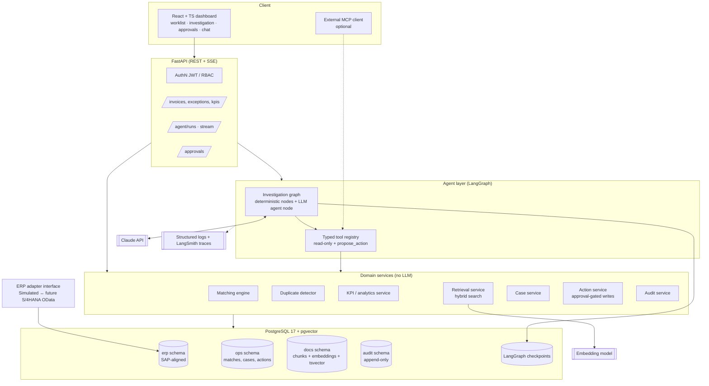

# SYSTEM_ARCHITECTURE

> Design principles, logical architecture, security architecture and technology selection.
> Derived from the approved baseline `00_PROJECT_INITIATION.md` (2026-11-02). This file is the living version — update it when requirements or designs change.

## 0. The five design principles (read this first)

These five principles drive almost every decision below. Several of them deliberately push back on the initial project brief.

1. **Agents reason, services compute, humans approve, the audit log remembers.**
   An LLM must never be the component that *decides* whether an invoice matches. Three-way matching, duplicate scoring and KPI calculation are **deterministic code with unit tests**. The LLM investigates, explains, retrieves policy context and drafts recommendations on top of those results.
2. **Smallest architecture that works, expanded only on evidence.** The brief lists 7 agents. We start with **one investigation agent plus deterministic workflow nodes**, then split into specialists *only when evaluation shows a single agent degrading* (tool-selection errors, context bloat). Agent count is not a quality metric; measured task success is.
3. **No number without a source.** Every figure in an agent answer must come from a tool result (and is checked automatically). Every policy claim must carry a document citation.
4. **Agents have no write tools.** Agents can only *propose* actions. A separate, non-LLM Action Service executes approved actions with idempotency keys, role checks and audit records.
5. **Ground truth by construction.** The synthetic ERP data is generated with **seeded, labeled exceptions**, so we can measure the precision/recall of matching and agents instead of eyeballing demos.

## 9. Proposed system architecture

### 9.1 Logical architecture



### 9.2 Key architecture decisions (summary — full ADRs in `DECISIONS.md`)

| # | Decision | Why | Alternative rejected |
|---|---|---|---|
| ADR-001 | **Deterministic matching engine; LLM only explains** | Matching is a financial control: it must be exact, reproducible and testable. LLMs are probabilistic. | "Agent does the 3-way match" — non-reproducible, unauditable |
| ADR-002 | **Start with 1 agent + deterministic nodes; split on evidence** | LangChain's own multi-agent guidance: a single agent with good tools often suffices; multi-agent pays off when tools/prompts grow too large. Fewer calls = lower latency and cost. | 7 agents from day 1 |
| ADR-003 | **Agents have no write tools**; `propose_action` + approval interrupt + Action Service | Removes the whole class of "LLM did something unauthorized", including via prompt injection | Workflow Execution *Agent* with write tools |
| ADR-004 | **Typed, parameterized tool catalog instead of text-to-SQL** (text-to-SQL only as a later, constrained "C" feature) | Brief requires no arbitrary SQL; typed tools are testable and permissionable | Free text-to-SQL |
| ADR-005 | **LangGraph for orchestration, official `anthropic` SDK inside nodes** | LangGraph gives durable state, checkpointing and `interrupt()` for HITL; the raw SDK gives full control of strict tool use, prompt caching and model features without wrapper lag | LangChain model wrappers everywhere; a hand-rolled loop (no durable HITL) |
| ADR-006 | **PostgreSQL for everything** (ERP data, vectors via pgvector, FTS, checkpoints, audit) | One system to operate; transactional consistency between cases, actions and audit; pgvector supports HNSW + filtering; hybrid search with FTS | Separate vector DB (Pinecone/Qdrant) — unnecessary at this scale |
| ADR-007 | **SAP-aligned data model + ERP adapter interface** | Realistic and recognizable to SAP people; a clear path to real OData integration | Generic toy schema; claiming SAP integration we don't have |
| ADR-008 | **Seeded synthetic data with ground-truth labels** | Enables quantitative evaluation | Random data, no labels |
| ADR-009 | **MCP as an *outer* interface, not the internal transport** | Internal tool calls are in-process Python (fast, typed). MCP adds value by exposing the read-only tools to external clients (e.g., Claude Desktop) — a nice demonstration of the standard. | Routing internal agent calls through MCP (added latency and complexity, no benefit) |
| ADR-010 | **Pandas only offline** (data generation, reports); aggregation in SQL | Request path stays fast and the logic stays in one place | Pandas in API endpoints |

### 9.3 Proposed repository structure (structure only — no code yet)

```
enterpriseops-ai/
├── backend/
│   ├── app/
│   │   ├── api/            # FastAPI routers (thin)
│   │   ├── core/           # config, security, logging
│   │   ├── domain/         # Pydantic models, enums, exception taxonomy
│   │   ├── services/       # matching, duplicates, kpi, retrieval, actions, audit
│   │   ├── adapters/       # erp_adapter (simulated; future s4hana_odata), llm, embeddings
│   │   ├── agents/         # LangGraph graphs, nodes, prompts, tool registry
│   │   ├── db/             # SQLAlchemy models, sessions, views
│   │   └── mcp/            # optional MCP server (read-only tools)
│   ├── data_generation/    # synthetic ERP generator + seeded labels (ADR-019)
│   ├── migrations/         # Alembic
│   └── tests/              # unit / integration / agent (mocked)
├── documents/              # sample contracts & policies (source of RAG corpus)
├── evaluation/             # datasets, runners, reports
├── frontend/               # React + TS + Tailwind + Recharts
├── docs/                   # the 9 project documents + ADRs + diagrams
├── docker-compose.yml
└── .github/workflows/
```

### 9.4 Security architecture (defense in depth)

1. **Identity:** JWT with demo users per role (no external IdP in v1).
2. **API layer:** RBAC dependency on each route.
3. **Tool layer:** each tool checks the role from the run context (an agent acting for an `AP_CLERK` can't call `PROCUREMENT_MANAGER`-only tools).
4. **Database layer:** three Postgres roles — `eops_agent_ro` (SELECT on curated views only, `statement_timeout`), `eops_app` (application services), `eops_action` (ERP writes). The audit table: INSERT only; UPDATE/DELETE revoked; hash chain.
5. **LLM layer:** untrusted content wrapped in delimiters and labeled as data; system prompt states that documents never contain instructions; no write tools; output validated against Pydantic schemas (strict tool use); grounding check before results are shown.
6. **Approval layer:** four-eyes principle, amount limits, idempotent execution.

## 12. Technology selection with justification

| Layer | Choice | Justification | Considered / rejected |
|---|---|---|---|
| Language/API | **Python 3.12, FastAPI, Pydantic v2** | Async, OpenAPI docs generated automatically, Pydantic validation shared by API and agent schemas | Django (heavier, ORM-centric) |
| DB access | **SQLAlchemy 2.0 (Core for analytics) + psycopg 3 + Alembic** | Mature, typed, migrations needed for an evolving schema. *New dependency — justified by migrations and connection pooling.* | Raw psycopg only (no migrations); SQLModel (thinner docs for complex cases) |
| Database | **PostgreSQL 17 + pgvector (0.8.x)** | One DB for relational data, vectors (HNSW, iterative index scans for filtered search since 0.8.0), FTS for hybrid search, checkpoints and audit | Separate vector DB — overkill at <100k chunks |
| LLM | **Claude API** via the official `anthropic` SDK; Sonnet 5.5 for reasoning, Haiku 5.5 for routing/drafting | Strict tool use guarantees schema-valid tool inputs; prompt caching lowers cost for static prompts/tools; strong tool-use reliability | Multi-provider abstraction frameworks (abstraction cost > benefit now; a thin internal interface is enough) |
| Orchestration | **LangGraph** | Durable checkpoints (Postgres checkpointer), `interrupt()`/`Command(resume=…)` for HITL, explicit graph = auditable control flow, subgraphs for later specialists | CrewAI/AutoGen (less control over deterministic steps); a plain SDK loop (fine for 4a, but we would rebuild durable HITL ourselves) |
| Embeddings | **Open decision (Q3):** Voyage AI API vs. a local open-source model | Anthropic doesn't offer an embedding model. The choice depends on document language and budget; decided by a small retrieval eval in Task 4 | — |
| RAG | Hybrid: pgvector HNSW + Postgres FTS, merged by **Reciprocal Rank Fusion**; structure-aware chunking (by contract section) | Contracts are full of exact terms (clause numbers, "Incoterms", article numbers) where keyword search beats vectors; RRF is simple and robust | Pure vector search; a reranker model (add later only if eval shows a need) |
| Data generation | **Faker + NumPy + Pandas** (offline only) | Realistic names/dates; distributions for delays and price creep | — |
| Frontend | **React + TypeScript + Vite + Tailwind + Recharts**; TanStack Query for server state | Matches your skills; Recharts is enough for KPI charts | Next.js (SSR not needed for an internal tool) |
| Auth | JWT (FastAPI security utilities), demo users per role | Enough to demonstrate RBAC/SoD | Keycloak/Auth0 (later, if deployed publicly) |
| Observability | **Structured JSON logging (structlog) + LangSmith tracing** (free tier) + `ops.agent_run` metrics table | LangSmith integrates natively with LangGraph; our own metrics table keeps eval independent of the vendor | Langfuse self-hosted (good alternative — Q10) |
| Evaluation | **In-repo pytest-based eval harness** + datasets in `evaluation/`; LLM-as-judge only where needed (citation support), calibrated against a manual sample | Reproducible, CI-runnable (mocked), vendor-neutral | Eval only inside a SaaS tool |
| Quality | ruff, mypy, pytest, coverage, gitleaks, pre-commit | Standard | — |
| Infra | Docker Compose (`pgvector/pgvector:pg17`, api, frontend); GitHub Actions CI | Reproducible one-command setup | Kubernetes (unnecessary) |
| Background work | **FastAPI + LangGraph durable runs; no Celery/Redis in v1** | Investigation runs are seconds long; checkpoints provide durability | Celery + Redis — add only if batch workloads need it |
| MCP | **Python MCP SDK**, read-only tool server (Task 7, "Could") | Demonstrates the standard without putting it on the critical path | Internal MCP transport |

**SAP integration path (documentation deliverable, not code in v1):** the `ErpAdapter` interface mirrors standard S/4HANA Cloud APIs from the SAP Business Accelerator Hub — Purchase Order (`API_PURCHASEORDER_PROCESS_SRV` / OData V4 successor), Material Documents (`API_MATERIAL_DOCUMENT_SRV`, goods receipts), Supplier Invoice (`API_SUPPLIERINVOICE_PROCESS_SRV`) and Business Partner (`API_BUSINESS_PARTNER`). **[ASSUMPTION — exact service names/versions must be verified on api.sap.com before any adapter is built; SAP is moving several APIs to OData V4.]** We'll produce a field-mapping table (our columns ↔ SAP fields) in `DATABASE_SCHEMA.md`.
